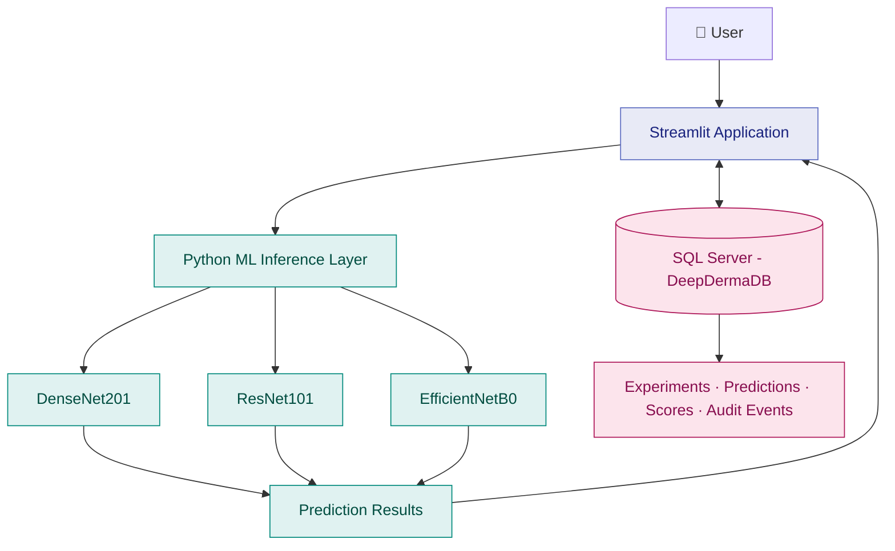

# 🧬 DeepDerma LabOps

**An ML-powered skin image analysis application combining deep learning, interactive visualization, and reliable data management.**

DeepDerma explores how deep learning and computer vision can be integrated into an interactive application for skin-condition image analysis. The project brings together multiple convolutional neural network (CNN) architectures, a Streamlit interface, and Microsoft SQL Server to support model comparison, prediction history, and structured data management.

Beyond the machine learning workflow, the project explores the engineering practices that make an application more maintainable and reliable, including database security, automated backups, recovery validation, and query performance optimization.

> **Focus areas:** Deep Learning · Computer Vision · Python · Streamlit · SQL Server

---


## 🏗️ Project Architecture




## ✨ Key Features

- **Multi-model image analysis** — Compare predictions from DenseNet201, ResNet101, and EfficientNetB0.
- **Model score exploration** — Review model outputs across the four classes used during training.
- **Interactive interface** — Upload images and explore analysis results through a Streamlit application.
- **Database-backed records** — Store and organize model information, experiments, predictions, prediction scores, and audit events.
- **Controlled database access** — Use application-specific SQL Server permissions instead of relying on unrestricted database access.
- **Backup and recovery workflows** — Implement full, differential, and transaction-log backups, with point-in-time recovery validation.
- **Query performance tuning** — Evaluate index-based optimization using SQL Server execution and logical-read evidence.

## 🧠 Machine Learning

DeepDerma integrates three CNN architectures for image classification:

| Model | Role |
|---|---|
| DenseNet201 | Deep-learning image classification |
| ResNet101 | Residual-network-based image classification |
| EfficientNetB0 | Efficient convolutional image classification |

The application provides a common interface for comparing model outputs and exploring the classes included in the training dataset.

The trained model files are not included in this repository. See the setup section before running the application.

**Important:** Model outputs are experimental classifications, not medically validated diagnoses. They should not be used to make healthcare decisions.

## 🖥️ Application and Data Layer

The Streamlit application provides the user interface for image uploads and model comparisons. Python handles application logic and model inference, while Microsoft SQL Server stores structured application records.

The database layer supports:

- Model and experiment records
- Prediction history and per-model class scores
- Audit-event records
- Application connectivity using environment-based credentials
- Restricted application permissions

This separation of the interface, inference logic, and persistent data helps demonstrate how machine-learning applications can be supported by a structured backend.

## 🗄️ Database Engineering and Reliability

SQL Server is an important part of DeepDerma's supporting infrastructure, providing opportunities to explore practical database administration alongside application development.

### Backup and recovery

- Full, differential, and transaction-log backup workflows
- SQL Server Agent jobs for backup automation
- Backup verification using checksums and restore validation
- Point-in-time recovery tested against a separate validation database
- Database consistency checking with `DBCC CHECKDB`

**Recovery scope:** Point-in-time recovery was validated for the documented test scenario. The complete seven-day retention window has not yet been verified.

### Security

- SQL logins, database users, roles, and permissions
- Restricted permissions for the application database user
- Environment-based password handling rather than hardcoded credentials

### Performance optimization

An index-tuning exercise reduced logical reads from **14 to 2** for the tested query — an approximately **85.7% reduction in logical reads**.

This result applies to the measured test workload. It does not establish a corresponding improvement in query elapsed time.

### Automation and documentation

PowerShell supports local application startup, while SQL Server Agent handles scheduled database jobs. Supporting documentation covers backup retention, point-in-time recovery, project architecture, and validation evidence.

## 🛠️ Technology Stack

| Area | Technologies |
|---|---|
| Machine learning | TensorFlow/Keras, DenseNet201, ResNet101, EfficientNetB0 |
| Programming | Python |
| User interface | Streamlit |
| Database | Microsoft SQL Server 2022, T-SQL |
| Database administration | SQL Server Management Studio (SSMS), SQL Server Agent |
| Automation | Windows PowerShell |
| Testing and version control | Python tests, Git, GitHub |

## 📂 Repository Structure

```text
DeepDerma-LabOps/
├── app/                 # Streamlit application and model/database logic
├── database/            # SQL schema, seed scripts, and database tests
├── docs/                # Project overview, recovery runbook, and retention policy
├── screenshots/         # Application and database validation evidence
├── artifacts/           # Model reference hashes
├── tests/               # Automated tests
├── run_app.ps1          # Local application launcher
├── README.md
└── .gitignore
```

## 🚀 Getting Started

### Prerequisites

- Windows
- Python and the project's required Python packages
- Microsoft SQL Server with the required database and schema
- The trained model files required by the application

### Setup

1. Clone the repository:

   ```powershell
   git clone https://github.com/MounikaBeera/DeepDerma-LabOps.git
   cd DeepDerma-LabOps
   ```

2. Review the SQL scripts in `database/`, particularly `01_create_schema.sql` and `02_seed_models.sql`, before running them in your own SQL Server environment.

3. Configure the database connection in `app/database.py` for your SQL Server instance and database.

4. Obtain the trained model files separately and place them in the expected `models/` directory. The model files are excluded from this repository because of their size.

5. Review `run_app.ps1` and adjust its local Python import path if your environment differs. Ensure the required Python packages are installed.

6. Launch the application from PowerShell:

   ```powershell
   .\run_app.ps1
   ```

   The launcher prompts for the SQL application login password when it starts.

**Security note:** Never commit database passwords, access tokens, or other secrets. Use a dedicated application login with appropriate permissions, and configure your local environment for your own SQL Server instance.

## 📸 Project Evidence

The `screenshots/` directory includes evidence of:

- The application interface
- SQL Server Agent backup jobs
- Point-in-time recovery execution
- Recovered database row counts
- Database integrity validation
- Query execution-plan and logical-read comparisons
- Backup retention reporting

Detailed procedures and limitations are documented in the `docs/` directory.

## ⚠️ Scope and Limitations

- This is an academic and portfolio project, not a production-ready medical diagnostic system.
- Image classifications are experimental and are not a substitute for professional medical advice.
- Trained model files are not distributed in this repository.
- Database scripts and configuration should be reviewed and adapted before use in another environment.
- Backup retention coverage should not be considered fully verified until the complete retention window has been validated.

## 👩‍💻 Author

**Mounika Beera**


Interested in SQL Server database administration, Python development and data systems.

---

*DeepDerma LabOps brings together machine learning, application development, and database engineering in one end-to-end project.*
