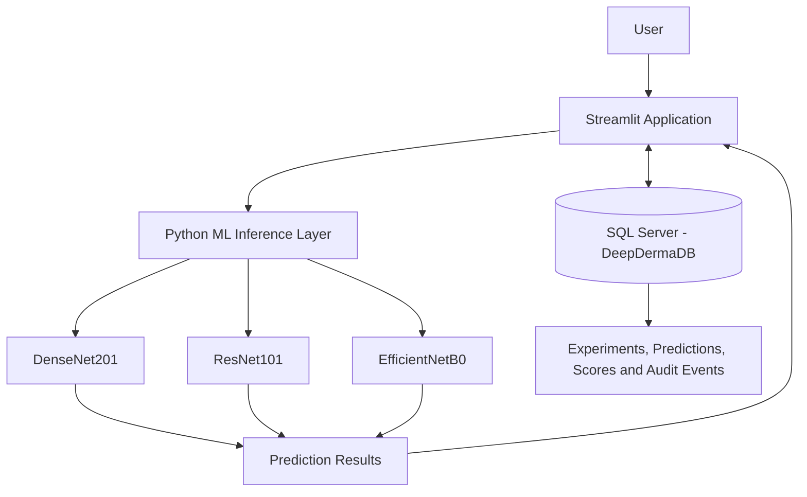

# 🧬 DeepDerma LabOps

**An ML-powered skin image analysis application combining deep learning, interactive visualization, and reliable data management.**

DeepDerma explores how deep learning and computer vision can be integrated into an interactive application for skin-condition image analysis. The project brings together multiple convolutional neural network (CNN) architectures, a Streamlit interface, and Microsoft SQL Server to support model comparison, prediction history, and structured data management.

Beyond the machine learning workflow, the project explores the engineering practices that make an application more maintainable and reliable, including database security, automated backups, recovery validation, and query performance optimization.

**Focus areas:** Deep Learning · Computer Vision · Python · Streamlit · SQL Server · Database Administration

---

## 🏗️ Project Architecture



## ✨ Key Features

- **Multi-model image analysis** — Compare predictions from DenseNet201, ResNet101, and EfficientNetB0.
- **Model score exploration** — Review model outputs across the four classes used during training.
- **Interactive interface** — Upload images and explore analysis results through a Streamlit application.
- **Database-backed records** — Store and organize model information, experiments, predictions, prediction scores, and audit events.
- **Controlled database access** — Use application-specific SQL Server permissions instead of unrestricted database access.
- **Backup and recovery workflows** — Demonstrate full, differential, and transaction-log backups, with point-in-time recovery validation.
- **Query performance tuning** — Evaluate index-based optimization using SQL Server logical-read measurements.
- **Reproducible administration labs** — Provide SQL scripts and documentation for setup, backup inventory, recovery, security, and tuning.

## 🧠 Machine Learning

DeepDerma integrates three CNN architectures for image classification.

| Model | Role |
|---|---|
| DenseNet201 | Deep-learning image classification |
| ResNet101 | Residual-network-based image classification |
| EfficientNetB0 | Efficient convolutional image classification |

The application provides a common interface for comparing model outputs and exploring the classes included in the training dataset.

Trained model files are not included in this repository. Refer to the setup documentation for local configuration requirements.

**Important:** Model outputs are experimental classifications, not medically validated diagnoses. They should not be used to make healthcare decisions.

## 🖥️ Application and Data Layer

The Streamlit application provides the interface for image uploads and model comparisons. Python handles application logic and model inference, while Microsoft SQL Server stores structured application records.

The database layer supports:

- Model and experiment records
- Prediction history and per-model class scores
- Audit-event records
- Environment-based credential handling
- Restricted application permissions

This separation of the interface, inference logic, and persistent data demonstrates how a machine-learning application can be supported by a structured backend.

## 🗄️ Database Engineering and Reliability

SQL Server is a core component of DeepDerma's supporting infrastructure, providing opportunities to demonstrate practical database administration alongside application development.

### Backup and recovery

- Full, differential, and transaction-log backup workflows
- SQL Server Agent jobs for backup automation
- Backup verification using checksums and restore validation
- Point-in-time recovery tested against a separate validation database
- Database consistency checking with `DBCC CHECKDB`

**Recovery scope:** Point-in-time recovery was validated for the documented test scenario. The complete seven-day retention window has not yet been verified.

### Security

- SQL logins, database users, roles, and permissions
- Restricted permissions for the application database user
- Environment-based password handling instead of hardcoded credentials
- Application access designed around least privilege

### Performance optimization

An index-tuning exercise reduced logical reads from **14 to 2** for the tested query, an approximately **85.7% reduction in logical reads**.

This result applies to the measured workload. Elapsed time did not improve in the original test, so the reduction in logical reads should not be interpreted as proof of faster execution.

### Automation and documentation

PowerShell supports local application startup, while SQL Server Agent handles scheduled database jobs. Supporting scripts and documentation describe backup operations, recovery procedures, validation, security, and query tuning.

## 🛠️ Technology Stack

| Area | Technologies |
|---|---|
| Machine learning | TensorFlow/Keras, DenseNet201, ResNet101, EfficientNetB0 |
| Programming | Python, T-SQL |
| User interface | Streamlit |
| Database | Microsoft SQL Server, SQL Server Management Studio |
| Database administration | SQL Server Agent, backup and recovery, permissions, query tuning |
| Automation | Windows PowerShell |
| Testing and version control | Python tests, Git, GitHub |

## 📂 Repository Structure

```text
DeepDerma-LabOps/
├── app/                 # Streamlit application and database logic
├── artifacts/           # Model reference hashes
├── database/            # Schema, seed data, backup, recovery and tuning scripts
├── docs/                # Setup, recovery, retention and script documentation
├── notebooks/           # Portfolio notebook
├── screenshots/         # Application and database validation evidence
├── tests/               # Automated tests
├── run_app.ps1          # Local application launcher
├── README.md
└── .gitignore
```

The tree is a simplified overview. Refer to the repository for the complete file list.

## 📚 Documentation

- **[Setup Guide](docs/Setup-Guide.md)** — Configure the application on a local Windows environment.
- **[Database Scripts Review](docs/Database-Scripts-Review.md)** — Understand the SQL scripts, intended usage, and validation limitations.
- **[Point-in-Time Recovery Runbook](docs/PITR-Recovery-Runbook.md)** — Review the documented recovery workflow.
- **[Backup Retention Policy](docs/Backup-Retention-Policy.md)** — Understand the retention approach and outstanding verification requirements.
- **[Project Overview](docs/Project-Overview.md)** — Explore the project background and architecture.

## 🚀 Getting Started

### Prerequisites

- Windows
- A compatible Python installation
- Microsoft SQL Server and SQL Server Management Studio
- The Python dependencies required by the application
- Trained model files compatible with the application

### Setup

1. **Clone the repository.**

   ```powershell
   git clone https://github.com/MounikaBeera/DeepDerma-LabOps.git
   cd DeepDerma-LabOps
   ```

2. **Configure Python.** Follow the [Setup Guide](docs/Setup-Guide.md) and install the project's dependencies in a compatible environment.

3. **Configure SQL Server.** Review `database/01_create_schema.sql` and `database/02_seed_models.sql`. Adapt the scripts to your instance and execute them in the documented order.

4. **Configure the connection.** Review `app/database.py` and supply your own SQL Server instance, database, and authentication settings. Configure the application login with only the permissions required by the app.

5. **Obtain the model files.** The trained model files are not distributed with this repository. Place compatible files in the expected local model directory and verify their paths before launching the application.

6. **Review the launcher.** Inspect `run_app.ps1` and update any machine-specific Python paths. Confirm the required packages are installed.

7. **Launch the application.**

   ```powershell
   .\run_app.ps1
   ```

   The launcher prompts for the SQL application login password. Review the script before running it in your own environment.

**Security note:** Never commit database passwords, access tokens, or other secrets. Use a dedicated application login, environment-based credentials, and appropriate permissions.

For detailed instructions and troubleshooting, see the [Setup Guide](docs/Setup-Guide.md).

## 🧪 Validation and Project Evidence

The project includes database and recovery validation work covering:

- Database consistency checks using `DBCC CHECKDB`
- Restored database status and table row-count comparisons
- Backup-history and retention reporting
- Query logical-read and execution-plan comparisons
- SQL Server Agent backup automation
- Point-in-time recovery testing

## 🎬 Application Demo

Watch the walkthrough to see DeepDerma-LabOps in action, including image analysis, ML prediction results, and application functionality.

[**▶ View the DeepDerma-LabOps Demo Video**](screenshots/DeepDerma-LabOps-Demo.mp4)

### Screenshots

Explore the application screenshots in the [`screenshots/`](screenshots/) directory.

## ⚠️ Scope and Limitations

- This is an academic and portfolio project, not a production-ready medical diagnostic system.
- Image classifications are experimental and are not a substitute for professional medical advice.
- Trained model files are not distributed in this repository.
- Database scripts and configuration should be reviewed and adapted before use in another environment.
- The complete seven-day backup retention window has not been verified.
- Query performance results depend on the workload, data distribution, indexes, execution plan, and caching.
- A successful database consistency check does not, by itself, prove that every historical backup is recoverable.


## 👩‍💻 Author

**Mounika Beera**

Interested in SQL Server database administration, Python development, and data systems.

- **GitHub:** [MounikaBeera](https://github.com/MounikaBeera)
- **Project:** [DeepDerma-LabOps](https://github.com/MounikaBeera/DeepDerma-LabOps)

---

*DeepDerma LabOps brings together machine learning, application development, and database engineering in one end-to-end portfolio project.*
